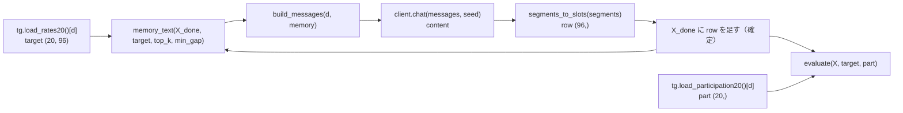

# ScheduleAgent

LLM に日本の 1 日の活動スケジュールを 1 人ずつ書かせ、社会生活基本調査 2021 の公表統計（集計表）に合わせる研究のリポジトリです。個票は使いません。

いま入っているのは最初の試行 `src/llm_memory_trial.py` です。条件は次の 2 つです。

- **none**: メモリなし。毎回同じプロンプトで 1 人ぶん書く
- **memory**: 生成済みの時刻別行動者率と集計表の差が大きい箇所（不足・超過それぞれ上位 `top_k` 個）を英語の文にして、次の人のプロンプトに足す

書いた活動スケジュールは確定とし、後から直しません。



## ファイル

| ファイル | 中身 |
|---|---|
| `src/llm_memory_trial.py` | 試行の本体。LLM には OpenAI 互換の API（llama.cpp の `llama-server` など）でつなぐ |
| `src/stula_targets.py` | 集計表 2 つを 28 群 × 20 活動の配列で読む。DomainTransfer_trial の `sa_targets.py`（コミット b76b51a）からの写し |
| `src/test_llm_memory_trial.py` | 単体テスト 7 項目。g は写し元と同じ値が読めるかを確かめる |

## 準備

```bash
uv venv --python 3.14 .venv
VIRTUAL_ENV=.venv uv pip install -r requirements.txt
```

集計表の CSV（`timeband_weekday.csv`・`timeuse_participation.csv`）の置き場所は、環境変数 `SCHEDULE_AGENT_STULA_DIR` で指定します。指定しなければ `data/processed/stula/` を読みます。`data/` と `outputs/` は git で管理しません。

## 実行

```bash
# テスト
.venv/bin/python src/test_llm_memory_trial.py

# サーバーにつながない空回し（形式とループの確認）
.venv/bin/python src/llm_memory_trial.py --dry-run --groups 5 --N 10 --tag dry

# llama-server を立ててから本番
.venv/bin/python src/llm_memory_trial.py --model-tag gemma4-12b --groups 5 0 --N 100
```

出力は `outputs/llm_memory_trial/{stem}/` に書かれます。同じ名前のフォルダに出力があると止まるので、試し回しには `--tag` を付けてください。
