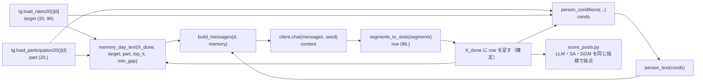

# ScheduleAgent

LLM に日本の 1 日の活動スケジュールを 1 人ずつ書かせ、社会生活基本調査 2021 の公表統計（集計表）に合わせる研究のリポジトリです。個票は使いません。

いま入っているのは試行 `src/llm_memory_trial.py` です。書いた活動スケジュールは確定とし、後から直しません（足すだけ）。条件は次の 4 つです。

| 条件 | メモリの中身 |
|---|---|
| `none` | メモリなし。毎回同じプロンプトで 1 人ぶん書く |
| `memory` | 生成済みの時刻別行動者率と集計表の差が大きい箇所（不足・超過それぞれ上位 `top_k` 個）。11/17 の版 |
| `memory_day` | 日次行動者率の差と、差が大きい時間帯の「多すぎる活動・足りない活動」の組。集団の数字だけ |
| `memory_person` | `memory_day` に「この人の条件」（今日しない・する活動、ある時間帯にしている活動）を足す |



## ファイル

| ファイル | 中身 |
|---|---|
| `src/llm_memory_trial.py` | 試行の本体。LLM には OpenAI 互換の API（llama.cpp の `llama-server` など）でつなぐ |
| `src/schedule_metrics.py` | 採点の指標。較正に使う 2 表、評価だけに残す表（起床・就寝）、系列、R1〜R4 の違反、条件に従った割合 |
| `src/score_pools.py` | LLM・SA・DGM（2 段階学習）の生成物を同じ指標で採点し、1 つの CSV に書く |
| `src/stula_targets.py` | 集計表 2 つを 28 群 × 20 活動の配列で読む。DomainTransfer_trial の `sa_targets.py` からの写し |
| `src/stula_derived_times.py` | 公表の規則で起床・就寝時刻を決め、平均時刻編の公表値を読む。DomainTransfer_trial の `src/eval` などからの写し |
| `src/schedule_rules.py` | SA のルール R1〜R4 の違反を数える（評価だけに使う）。DomainTransfer_trial の `sa_core.py` からの写し |
| `src/test_llm_memory_trial.py` | 単体テスト 11 項目。g と j は写し元と同じ値が返るかを確かめる |

## 準備

```bash
uv sync    # pyproject.toml・uv.lock から .venv を作る（Python 3.14）
```

集計表の CSV の置き場所は、環境変数 `SCHEDULE_AGENT_STULA_DIR` で指定します。指定しなければ `data/processed/stula/` を読みます。`data/` と `outputs/` は git で管理しません。

| CSV | 使うところ |
|---|---|
| `timeband_weekday.csv`・`timeuse_participation.csv` | 生成（メモリ）と採点。LLM を回す端末にも要る |
| `meantime_wake.csv`・`meantime_bed.csv` | 採点だけ（評価だけに残す表） |

## 実行

```bash
# テスト
.venv/bin/python src/test_llm_memory_trial.py

# サーバーにつながない空回し（形式とループの確認）
.venv/bin/python src/llm_memory_trial.py --dry-run --conditions memory_day memory_person --groups 5 --N 10 --tag dry

# llama-server を立ててから本番
.venv/bin/python src/llm_memory_trial.py --model-tag gemma4-12b --groups 5 0 --N 100 \
    --conditions memory_day memory_person --tag v2 --extra-json '{"top_k": 64}'

# 採点（LLM の出力フォルダと SA の pool を並べる）
.venv/bin/python src/score_pools.py --llm outputs/llm_memory_trial/llm_gemma4-12b_N100_seed42 \
    --sa ../DomainTransfer_trial/outputs/generated/sa_aggregate/sa_rules_K100000_N100_seed42_pool.npz \
    --groups 5 0 --out outputs/score_pools/scores.csv
```

出力は `outputs/llm_memory_trial/{stem}/` に書かれます。同じ名前のフォルダに出力があると止まるので、試し回しには `--tag` を付けてください。
